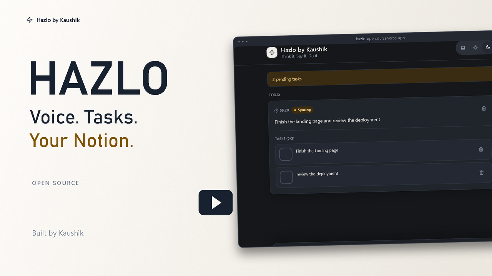
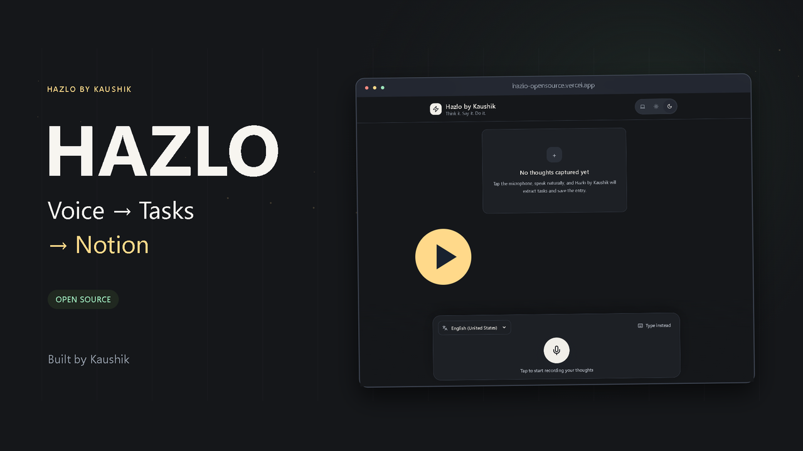
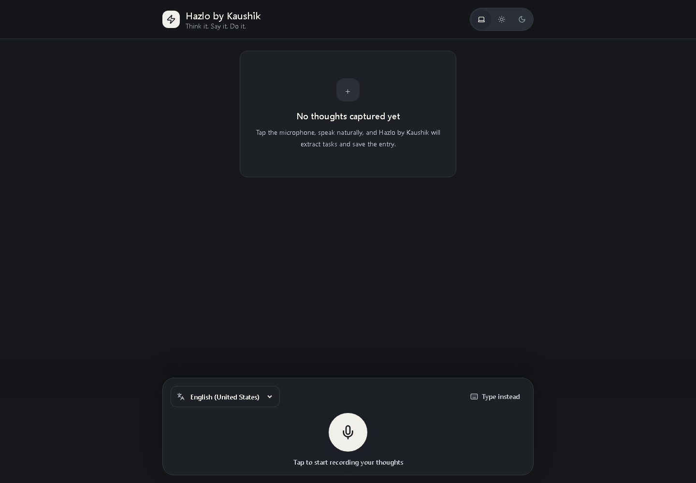

# Hazlo by Kaushik

Hazlo is an open-source, voice-first task capture app that turns spoken or typed thoughts into local task entries and optionally syncs them to your own Notion workspace through a small Vercel backend. Public demos default to local-only capture; personal Notion writes require explicit opt-in.

Created and maintained by [Kaushik (@YellankiKaushik)](https://github.com/YellankiKaushik).

[](https://react.dev/)
[](https://vite.dev/)
[](https://www.typescriptlang.org/)
[](https://vercel.com/)
[](https://developers.notion.com/)

## Live Demo

[https://hazlo-opensource.vercel.app](https://hazlo-opensource.vercel.app/)

## Watch Hazlo in Action

See how Hazlo turns spoken or typed thoughts into organized tasks, saves entries locally, and syncs them to your own Notion workspace.

### Hazlo — 32-Second Product Teaser

A quick look at Hazlo's voice-first capture workflow, task extraction, Notion sync, and open-source setup.

<a href="docs/media/hazlo-launch-teaser-v2.mp4"></a>

**0:32** · [View video on GitHub](docs/media/hazlo-launch-teaser-v2.mp4) · [Direct MP4 — open/download](https://raw.githubusercontent.com/YellankiKaushik/Hazlo-OpenSource/main/docs/media/hazlo-launch-teaser-v2.mp4) · [Captions](docs/media/hazlo-launch-teaser-v2.srt)

### Hazlo — Full 95-Second Product Overview

A more detailed walkthrough of the Hazlo application, its workflow, technical foundation, and how to run your own version.

<a href="docs/media/hazlo-full-promotional-video.mp4"></a>

**1:35** · [View video on GitHub](docs/media/hazlo-full-promotional-video.mp4) · [Direct MP4 — open/download](https://raw.githubusercontent.com/YellankiKaushik/Hazlo-OpenSource/main/docs/media/hazlo-full-promotional-video.mp4) · [Captions](docs/media/hazlo-full-promotional-video.srt)

GitHub may show a file/download page rather than an inline player. Use **Direct MP4** to open or download the video for playback; no repository clone is needed. See the [media guide](docs/media/README.md) for sharing links, source code, and licensing. The [earlier promotional video](docs/media/hazlo-promotional-video.mp4) remains available.

## Preview



Current Hazlo interface with voice/manual capture, task extraction, sync status, and theme controls.

## What Hazlo Does

Hazlo is built for fast personal capture:

```text
Speak or type
  -> Hazlo extracts tasks
  -> Entries save in your browser
  -> Entries sync to Notion
```

The app keeps the raw thought as the source text, extracts likely tasks locally, saves immediately to browser storage, and then sends the entry to a Vercel API route that writes to Notion.

## Features

- Voice input with browser speech recognition.
- Manual "Type instead" fallback when speech is unavailable or typing is faster.
- Automatic task extraction from simple task phrases, bullets, numbered lists, and "and" separated actions.
- Local persistence with Zustand and `localStorage`.
- Notion synchronization through a server-side Vercel Function.
- Retry handling for failed Notion sync attempts.
- Dark, light, and system theme support.
- Responsive UI for desktop and mobile.
- PWA metadata, manifest, and install icons.
- Vercel backend route for protecting the Notion token from the browser bundle.

## How It Works

```text
Browser
|
+-- React UI
|
+-- Zustand/localStorage
|
+-- Task extractor
|
+-- POST /api/notion-sync
|
+-- Vercel Function
|
+-- Notion API
```

In plain English:

1. You speak into the browser or type a note manually.
2. React shows the UI and sends the final text into the app store.
3. Zustand saves the entry in `localStorage` first, so the entry remains after refresh.
4. The task extractor creates local task items from the text.
5. The frontend posts the entry to `/api/notion-sync`.
6. When explicitly enabled, the Vercel Function checks bounded input and the approved browser origin, reads server-only Notion credentials, and creates a Notion page. Origin checks do not authenticate the owner.
7. If sync fails, the local entry stays available and shows a retry action.

## Tech Stack

| Technology | What it does in Hazlo |
| --- | --- |
| React | Builds the user interface. |
| Vite | Runs the local dev server and builds the production frontend. |
| TypeScript | Adds type checking to the app code. |
| Zustand | Stores entries, tasks, sync status, and voice UI state. |
| Tailwind CSS | Provides utility classes and theme-friendly styling. |
| Vitest | Runs unit tests for extraction, sync, speech, theme, store, and PWA behavior. |
| Vercel | Hosts the frontend and the `/api/notion-sync` serverless function. |
| Notion API | Creates Notion pages and task blocks in your workspace. |
| pnpm | Installs dependencies and runs project scripts. |

## Prerequisites

You need:

- Git, for cloning the repository.
- Node.js, for running JavaScript tooling.
- pnpm, for installing packages and running scripts.
- A Notion account, for the destination data source.
- A Vercel account, if you want your own deployed backend and public URL.

Check your tools:

```bash
git --version
node --version
pnpm --version
```

If `pnpm --version` fails but Node and npm are installed, install pnpm:

```bash
npm install -g pnpm
```

Vercel CLI is only needed for full-stack local development with Vercel Functions. You can deploy through the Vercel website without installing it globally.

## Quick Start

1. Clone the repository.

```bash
git clone https://github.com/YellankiKaushik/Hazlo-OpenSource.git
cd Hazlo-OpenSource
```

2. Install dependencies.

```bash
pnpm install
```

3. Create your local environment file.

```bash
cp .env.example .env.local
```

On Windows PowerShell:

```powershell
Copy-Item .env.example .env.local
```

4. Optionally create a Notion integration/data source using the setup below. It is not needed for local capture.

5. Keep both sync flags false for local-only use. To enable personal sync, follow the environment and security sections below; no frontend shared secret is used.

6. Run the frontend.

```bash
pnpm dev
```

7. Run the full local backend when you need to test Notion sync locally.

```bash
npm install -g vercel
vercel link
vercel env pull .env.local --environment=development
vercel dev
```

Use `vercel env pull` only when the values already exist in Vercel. If you filled `.env.local` manually, keep that file and run `vercel dev`.

8. Run validation before committing changes.

```bash
pnpm test
pnpm typecheck
pnpm build
git diff --check
```

For a slower, more detailed walkthrough, see [docs/SETUP.md](docs/SETUP.md).

## Notion Setup: Very Important

Hazlo writes to a [Notion data source](https://developers.notion.com/reference/data-source). In the Notion app, this usually appears as a database table, but Hazlo's backend sends a `data_source_id`.

1. Open [Notion integrations](https://www.notion.so/profile/integrations).
2. Create a new internal integration.
3. Copy the integration token. This becomes `NOTION_TOKEN`.
4. In the integration capabilities, allow the integration to read and insert content so it can access the data source and create pages.
5. Create a new Notion database or choose an existing one.
6. Open the database as a full page.
7. Add the integration to the database from the Notion share/connections menu.
8. Copy the data source ID. In current Notion, open the database settings, choose "Manage data sources", open the data source menu, and copy the data source ID. If your Notion UI does not show that option, use the Notion API to [retrieve the parent database](https://developers.notion.com/reference/retrieve-a-database) and read the `data_sources` array.
9. Put that value in `NOTION_DATA_SOURCE_ID`.

Create these exact properties in the target Notion data source:

| Property name | Type | Required details |
| --- | --- | --- |
| `Raw Speech` | Title | Stores the transcript title. |
| `Status` | Status | Must include `Not started`, `In progress`, and `Done`. |
| `Date` | Date | Stores the original Hazlo entry timestamp. |

Extra Notion columns are allowed. Hazlo will ignore columns it does not write.

A built-in Notion "Created time" property is not a substitute for the custom `Date` property. The backend explicitly writes to a property named `Date`.

## Environment Variables

Environment variables are settings outside the source code. Copy `.env.example` to the ignored `.env.local` for local work; use Vercel Project Settings for deployment. Never commit real credentials.

| Variable | Used by | Meaning |
| --- | --- | --- |
| NOTION_SYNC_ENABLED | Server | Defaults false; exactly true permits anonymous remote writes. |
| VITE_NOTION_SYNC_ENABLED | Browser build | Defaults false; exactly true enables the frontend sync pipeline. Public flag, not a credential. |
| NOTION_TOKEN | Server only | Your private Notion integration token, required only for enabled personal sync. |
| NOTION_DATA_SOURCE_ID | Server only | UUID of your connected Notion data source. |
| NOTION_ALLOWED_ORIGINS | Server only | Exact approved app origin, such as https://your-app.vercel.app, without a trailing slash. |

```env
NOTION_SYNC_ENABLED=false
VITE_NOTION_SYNC_ENABLED=false
NOTION_TOKEN=your_notion_token_here
NOTION_DATA_SOURCE_ID=your_notion_data_source_id_here
NOTION_ALLOWED_ORIGINS=
```

For personal sync, set both flags to exactly true, supply your own token/ID, and set the actual app origin. Keep frontend and API same-origin. Vercel Preview writes are always disabled; do not supply Preview with Notion credentials.

**Hazlo has no login. An enabled public endpoint can be called by anyone who imitates the public request format.** Origin/CORS checks, entry IDs and rate limits are not owner authentication. Configure provider abuse/access controls before enabling writes, use a dedicated non-sensitive Notion destination, and read [SECURITY.md](SECURITY.md).

The exposed API_SECRET/VITE_API_SECRET mechanism is retired, along with VITE_API_BASE_URL. Remove these old values from local/Vercel settings. Retire the old shared secret and rotate it anywhere reused. Do not replace it with another browser token.

## Local Development

### Frontend Only

```bash
pnpm dev
```

This starts the Vite dev server, usually at `http://localhost:5173`.

Frontend-only mode is useful for UI work, theme checks, task extraction, and localStorage behavior. Local-only capture works in this mode. Enabled Notion sync requires the same-origin Vercel `/api/notion-sync` function, which Vite alone does not run.

### Full Stack With Vercel

Install the Vercel CLI if needed:

```bash
npm install -g vercel
```

Link the project and pull local env values:

```bash
vercel link
vercel env pull .env.local --environment=development
```

Use `vercel env pull` only if the variables already exist in Vercel. If you are setting up locally first, fill `.env.local` manually from `.env.example` instead.

Run the Vercel local runtime:

```bash
vercel dev
```

Use this mode when you want local frontend plus local `/api/notion-sync` behavior.

## Testing

Run:

```bash
pnpm test
pnpm typecheck
pnpm build
git diff --check
```

What they verify:

| Command | Purpose |
| --- | --- |
| `pnpm test` | Runs Vitest unit tests. |
| `pnpm typecheck` | Runs TypeScript without emitting files. |
| `pnpm build` | Builds the production Vite bundle. |
| `git diff --check` | Checks changed lines for whitespace errors. |

The tests mock browser and network behavior. They do not use a real microphone, real Notion token, or real Notion workspace.

## Deploying to Vercel: Beginner Guide

1. Fork this repository or push your copy to your own GitHub account.
2. Open [Vercel](https://vercel.com/) and create a new project.
3. Import your GitHub repository.
4. Let Vercel detect the Vite framework preset.
5. Set the install command to `pnpm install --frozen-lockfile` if Vercel asks.
6. Set the build command to `pnpm build` if Vercel asks.
7. Confirm the output directory is `dist`.
8. Start with both sync flags false for a safe public demo. To opt into personal writes, configure the five documented variables and provider abuse controls in Vercel Project Settings.
9. Make sure the required variables are enabled for Production.
10. Deploy.
11. If you change any environment variable later, redeploy. This is especially important for `VITE_` variables because Vite injects them during build.
12. Visit the deployed URL.
13. Create a test entry.
14. For explicitly enabled personal sync only, confirm the fictional entry appears in your own Notion data source. Local-only entries show Saved locally.

For more deployment detail, see [docs/DEPLOYMENT.md](docs/DEPLOYMENT.md).

## Verifying Deployment

Use this checklist after deployment:

- Website loads.
- Theme toggle switches between system, light, and dark.
- "Type instead" creates an entry.
- Microphone works in browsers that support speech recognition.
- Entry remains after refreshing the page.
- Task extraction creates tasks for simple task phrasing.
- Disabled mode makes no sync POST. For explicitly enabled personal sync, one owner-approved fictional entry creates a Notion page.
- Retry appears and works when sync fails.

## Troubleshooting

Vercel function logs are the main place to diagnose backend problems. In Vercel, open the project, choose the deployment, and inspect function logs for `/api/notion-sync`.

| Problem | Likely cause | Fix |
| --- | --- | --- |
| Saved locally / `403 sync_disabled` | Sync is deliberately disabled, or this is a Vercel Preview. | Keep disabled for demos; follow personal opt-in instructions for your own instance. |
| `403 origin_not_allowed` | Unapproved Origin or cross-site request. | Set the exact same-origin app URL in NOTION_ALLOWED_ORIGINS; no wildcard/trailing slash. |
| `503` or `server_not_configured` | `NOTION_TOKEN` or `NOTION_DATA_SOURCE_ID` is missing in Vercel. | Add the missing server-side variable and redeploy. |
| `502` or `notion_sync_failed` | Notion rejected the request or the integration/schema is wrong. | Check Vercel logs, data source sharing, token, and schema. |
| `404 object_not_found` from Notion | Wrong data source ID, or the integration cannot access it. | Copy the data source ID again and share the data source with the integration. |
| `403 restricted_resource` from Notion | Integration permission or sharing issue. | Re-share the data source with the integration and check integration capabilities. |
| `400 validation_error` from Notion | Notion property schema mismatch. | Confirm `Raw Speech` is Title, `Status` is Status, and `Date` is Date. |
| Voice recognition unavailable | Browser/device support or microphone permission. | Try a Chromium-based browser, allow microphone access, or use "Type instead". |
| `VITE_` variable changed but app still behaves like the old value | Production frontend was not rebuilt. | Redeploy after changing any `VITE_` variable. |

## Project Structure

| Path | Purpose |
| --- | --- |
| `src/components` | Reusable UI pieces such as voice input, entries, tasks, header, and theme toggle. |
| `src/hooks` | React hooks for speech recognition and theme state. |
| `src/pages` | Page-level app composition. |
| `src/services` | Frontend service code for calling the backend sync route. |
| `src/store` | Zustand store, local persistence, entry creation, retry, and task actions. |
| `src/utils` | Task extraction, speech recognition controller, date helpers, and theme utilities. |
| `src/types` | Shared TypeScript types. |
| `api/notion-sync.js` | Vercel Function that validates requests and writes to Notion. |
| `public` | PWA manifest and icons. |
| `docs` | Deeper architecture, setup, deployment, production, and technical documentation. |

## Security

See [SECURITY.md](SECURITY.md) for the complete no-login threat model, payload limits, provider controls and credential migration. No global rate limiter or durable exactly-once delivery is claimed.

Entries exceeding sync limits stay local. POSTs are never automatically retried. After a timeout/unknown outcome, check Notion before confirming Retry; duplicates remain possible across server instances. localStorage is unencrypted and readable by same-origin scripts. Storage failures show a warning and preserve the original saved data.

- Never commit `.env`, `.env.local`, real Notion tokens, API secrets, Vercel credentials, or copied production values.
- Keep `NOTION_TOKEN` server-side only.
- Rotate leaked Notion tokens or API secrets immediately.
- Treat all `VITE_` variables as browser-visible.
- Hazlo is designed primarily for personal/self-hosted use.
- Hazlo does not provide complete multi-user authentication.

## Contributing

See [CONTRIBUTING.md](CONTRIBUTING.md).

## Author

Hazlo was created and is maintained by **Kaushik** ([@YellankiKaushik](https://github.com/YellankiKaushik)).

- GitHub: [https://github.com/YellankiKaushik](https://github.com/YellankiKaushik)
- Repository: [https://github.com/YellankiKaushik/Hazlo-OpenSource](https://github.com/YellankiKaushik/Hazlo-OpenSource)
- Live application: [https://hazlo-opensource.vercel.app](https://hazlo-opensource.vercel.app)

## License

Hazlo is released under the [MIT License](LICENSE). You can use, modify, and distribute it under the terms of that license.
